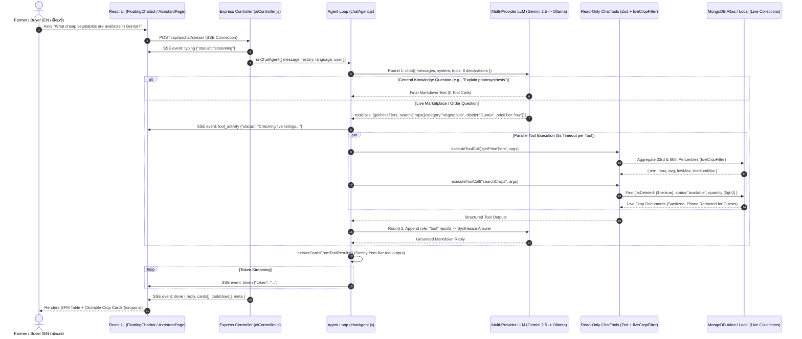
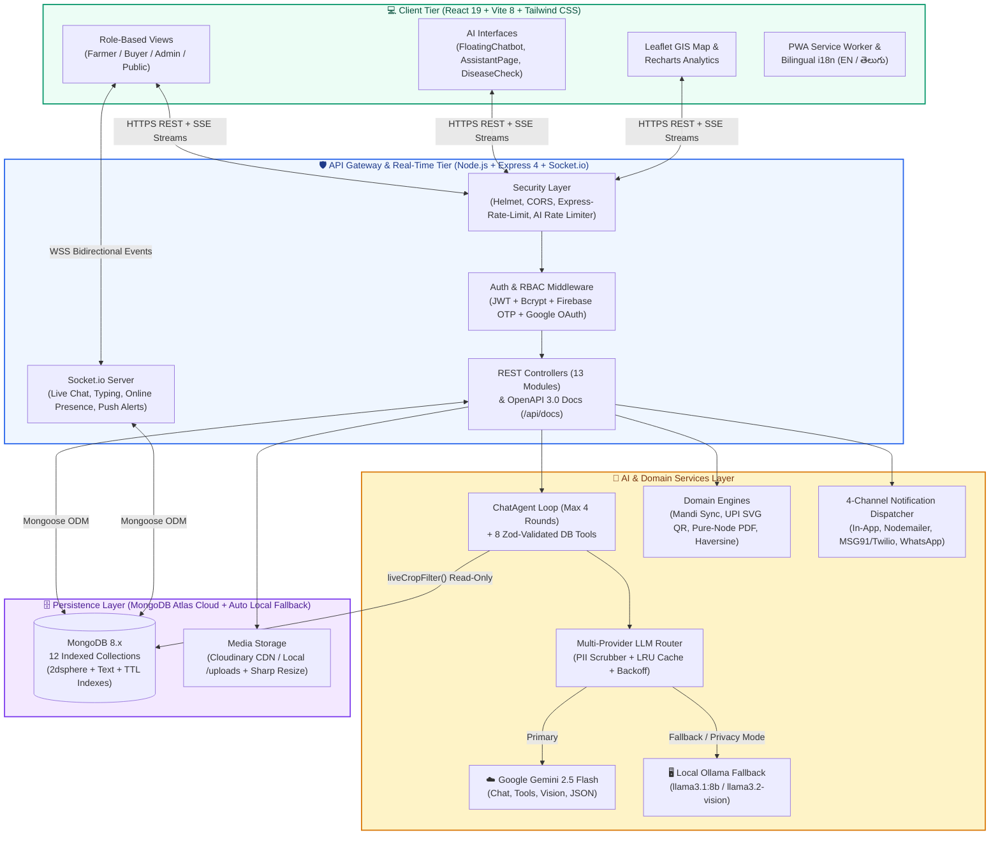
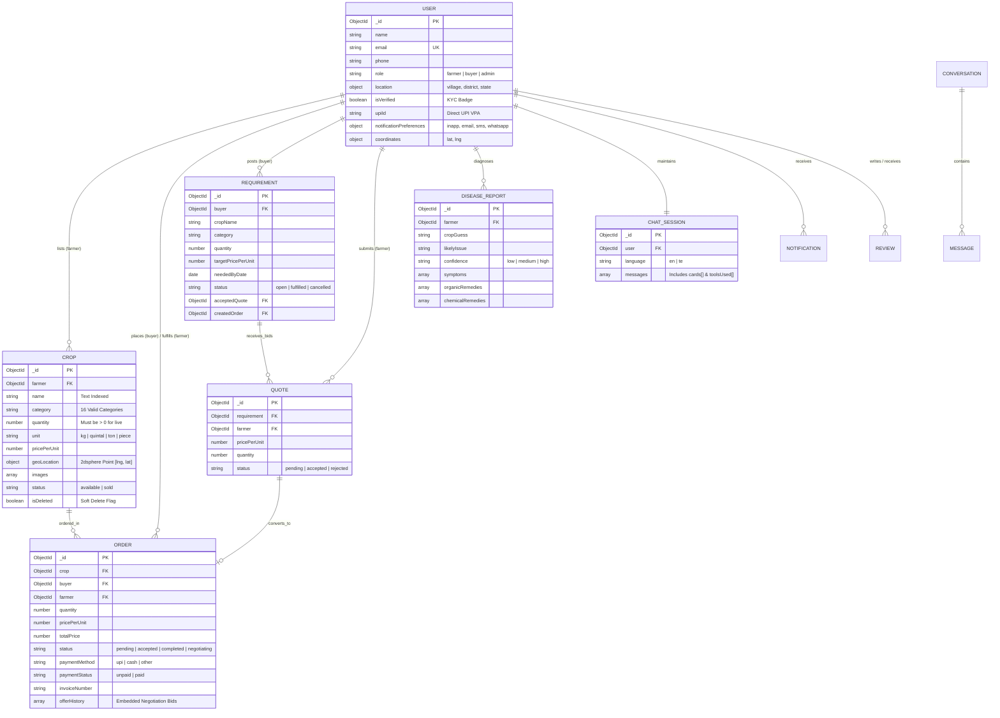

<div align="center">

# 🌾 AgriConnect

**An AI-Native, Zero-Middleman Farmer-to-Buyer Marketplace & Agricultural Intelligence Ecosystem Built for Bharat**

[](https://react.dev/)
[](https://vitejs.dev/)
[](https://tailwindcss.com/)
[](https://nodejs.org/)
[](https://expressjs.com/)
[](https://www.mongodb.com/)
[](https://socket.io/)
[](https://ai.google.dev/)
[](https://ollama.com/)
[](https://leafletjs.com/)
[](https://jwt.io/)
[](http://localhost:5000/api/docs)
[]()
[]()

<br />


<br />

[**🚀 Live Demo**](#-local-development--reproduction-guide-for-developers) • [**🤖 AI Engine**](#-ai-integration--intelligent-workflows-the-innovation-spotlight) • [**🏗️ Architecture**](#️-system-architecture--database-design-for-engineers--tech-interviews) • [**✨ Features**](#-comprehensive-feature-matrix-extracted-from-codebase) • [**📸 UI Gallery**](#-visual-product-tour--ui-showcase-2x2-html-grid) • [**🔌 API Docs**](#-complete-api-reference-extracted-from-backend-routes) • [**⚡ Quick Start**](#-local-development--reproduction-guide-for-developers)

</div>

---

## 🎯 Executive Summary & The Hackathon Pitch (For Judges & Recruiters)

### ⚡ TL;DR (For Busy Recruiters)
- **🤖 Multi-Provider Agentic AI Layer (`server/services/llm` + `chatAgent.js`):** Engineered a fault-tolerant LLM abstraction chaining **Google Gemini 2.5 Flash** (cloud primary), **Ollama `llama3.1:8b` / `llama3.2-vision`** (local offline/privacy fallback), and an **Anthropic stub** with exponential backoff + jitter, LRU caching, PII scrubbing, and a **4-round live database Tool-Calling Agent** (8 read-only Zod-validated tools + 33rd/66th percentile MongoDB price-tier aggregations).
- **🛒 Full-Cycle Bidirectional Marketplace & Reverse Bidding:** Supports both standard **Farmer-to-Buyer listings** (154 seeded Indian crop varieties across 16 categories) and a **Reverse Marketplace (`/requirements`)** where buyers post bulk procurement needs, farmers submit competitive quotes, and accepted quotes atomically convert into active orders.
- **💸 Zero-Commission Direct UPI QR Settlement & Pure-Node PDF Invoicing:** Eliminates middlemen and payment gateway fees via RFC-compliant `upi://pay` SVG QR code generation (`server/utils/upiQrGenerator.js`) and zero-dependency binary PDF 1.4 receipt generation (`server/utils/pdfInvoiceGenerator.js`).
- **📡 Real-Time Geospatial, WebSocket & Multi-Channel Architecture:** Features MongoDB `2dsphere` geospatial radius search (`react-leaflet` + Haversine transport cost estimator), JWT-authenticated **Socket.io** real-time chat with read receipts & typing indicators, and a pluggable 4-channel notification dispatcher (**In-App + SMTP Email + MSG91/Twilio SMS + Meta WhatsApp Cloud API**).

### 🚨 The Problem Statement
Indian smallholder farmers lose **30% to 45% of their final retail value** to multi-tier mandi intermediaries, opaque price discovery, and distress selling:
1. **Severe Information Asymmetry:** Farmers rarely know whether their asking price is below or above live regional market rates or official Government Agmarknet mandi benchmarks.
2. **High Digital Barrier & Language Divide:** Complex listing forms and English-only interfaces exclude Telugu and regional-speaking farmers from digital commerce.
3. **Crop Loss from Late Disease Diagnosis:** Leaf blights, viral curls, and pest infestations destroy yields before farmers can access an agronomist.
4. **Predatory Gateway Fees & Delayed Settlement:** Traditional e-commerce platforms charge 2–5% payment gateway commissions and hold farmer payouts in escrow for days.

### 💡 The AgriConnect Solution
**AgriConnect** is a bilingual (**English + తెలుగు**), AI-native direct-to-buyer marketplace that connects verified farmers and institutional/retail buyers with **zero platform commission**:
- Farmers snap a single crop photo and **AI Vision Auto-Fill** (`POST /api/ai/auto-list-photo`) populates the crop name, category, quality grade, bilingual description, and live mandi-suggested price in seconds.
- Farmers upload diseased leaf photos to **AI Crop Doctor** (`POST /api/ai/disease-check`) for instant symptom analysis, organic/chemical remedies, and prevention plans.
- Buyers and farmers converse with **AgriConnect Sahayak** (`POST /api/ai/chat/stream`), a bilingual streaming AI assistant powered by **Live Database Tool Calling** that queries real-time inventory, computes percentile price tiers, and renders clickable crop cards—while guaranteeing deleted or sold-out listings never appear.
- Settlements happen **directly farmer-to-buyer** via dynamic **UPI QR codes** and downloadable **PDF invoices**.

---

## 🧠 AI Integration & Intelligent Workflows (The Innovation Spotlight)

### 🔬 AI Tech Stack & Reliability Architecture
Located in [`server/services/llm/`](file:///e:/Agri%20Conct/server/services/llm/index.js), [`server/services/chatTools/`](file:///e:/Agri%20Conct/server/services/chatTools/index.js), and [`server/services/chatAgent.js`](file:///e:/Agri%20Conct/server/services/chatAgent.js):
- **Primary Cloud Model:** Google **Gemini API** (`gemini-2.5-flash` default via official REST `v1beta` / `@google/genai` SDK) supporting text generation, native `functionDeclarations` tool calling, SSE token streaming, and multimodal image vision.
- **Local Offline / Privacy Model:** **Ollama** (`/api/chat` with `llama3.1:8b` for chat/tools and `llama3.2-vision` for leaf & crop vision). Automatically forced when `LLM_PRIVACY_MODE=true` and a prompt contains user-specific data.
- **PII Scrubber (`server/services/llm/piiScrubber.js`):** Masks Indian phone numbers (`[PHONE_REDACTED]`), emails (`[EMAIL_REDACTED]`), Aadhaar/PAN/UPI tokens, street addresses, and user names before any payload leaves for a cloud LLM.
- **Resilience Controls:** Configurable provider chain (`LLM_PROVIDER_ORDER=gemini,ollama`), exponential backoff with random jitter on HTTP `429`/`5xx` (up to 2 retries per provider), 60s request timeout, in-memory TTL LRU cache (`server/services/llm/cache.js`), and dual-tier rate limiting (`aiGlobalLimiter` + `aiUserLimiter`).

### 🌟 Smart AI Capabilities Built Into AgriConnect

| AI Module | Endpoint & Route | User Input | Backend & AI Processing | Intelligent Output Delivered |
| :--- | :--- | :--- | :--- | :--- |
| **1. Tool-Calling Marketplace & General AI Assistant (`Sahayak`)** | `POST /api/ai/chat/stream` & `/assistant` | Any question in **English or Telugu** (general farming/science OR live marketplace queries) | [`runChatAgent`](file:///e:/Agri%20Conct/server/services/chatAgent.js) runs up to **4 tool-calling rounds** (5s timeout/tool). Answers general questions directly (`0` DB calls) or executes 8 read-only MongoDB tools in parallel. | SSE-streamed Markdown tables/lists + real-time `"Checking live listings..."` indicator + clickable `<ChatCropCards>` with live price tier badges. |
| **2. Vision Crop Disease Detector (`Crop Doctor`)** | `POST /api/ai/disease-check` & `/farmer/disease-check` | Leaf/plant photo (`JPEG/PNG/WebP` up to 5 MB) + optional crop name | Image resized via `sharp` (`1024x1024` JPEG q82) -> `llm.vision()` + `llm.json()` validated against `diseaseOutputSchema` with automatic retry on invalid JSON. | Structured `DiseaseReport` with `cropGuess`, `likelyIssue`, `confidence`, `symptoms[]`, `organicRemedies[]`, `chemicalRemedies[]`, `preventionTips[]`, and Kisan Call Centre (`1800-180-1551`) escalation banner. |
| **3. 1-Click Photo-to-Listing (`AI Auto-Fill`)** | `POST /api/ai/auto-list-photo` & `/farmer/add-crop` | Single photo of harvested produce on `/farmer/add-crop` | Multimodal vision extracts crop identity & quality grade (`A`/`B`/`C`), cross-references live mandi prices (`getMandiPrice`), and computes a ±15% suggested price range. | Auto-populates crop name, category, unit, quality grade, suggested price band (`min`/`max`/`modal`), and bilingual **English + Telugu** descriptions for farmer confirmation. |
| **4. Live Percentile Price-Tier Engine** | `getPriceTiers` & `searchCrops` in `chatTools` | Queries like *"Show cheap vegetables"* or *"High-priced spices"* | MongoDB `$match` + `$sort` + `$group` + `$project` pipeline computes live **33rd (`lowMax`) and 66th (`mediumMax`) percentiles** across active listings. | Classifies listings into **Low (≤33%)**, **Medium (33%–66%)**, and **High (>66%)** price bands alongside official Agmarknet mandi benchmarks. |

### 🔄 AI Tool-Calling & SSE Streaming Pipeline



---

## ✨ Comprehensive Feature Matrix (Extracted from Codebase)

### 👨‍🌾 For Farmers
- **📸 AI Vision Auto-Listing (`/farmer/add-crop`):** Upload a single crop photo to auto-detect crop name, category (across 16 categories), quality grade (`A/B/C`), bilingual English & Telugu descriptions, and live Agmarknet mandi price suggestions.
- **🩺 AI Leaf Disease Diagnostics (`/farmer/disease-check`):** Multimodal plant pathology scanner delivering confidence-scored diagnoses, organic & chemical treatment protocols, preventive agronomy tips, and saved diagnostic history (`DiseaseReport`).
- **📦 Inventory & Soft-Delete Lifecycle (`/farmer/my-crops`):** Manage crop quantity, unit (`kg`, `quintal`, `ton`, `dozen`, `litre`, `piece`), harvest dates, and GeoJSON farm coordinates. Deleting or selling out a crop immediately hides it across the marketplace and AI chatbot via `liveCropFilter()`.
- **🤝 Interactive Price Negotiation (`/farmer/orders`):** Accept, reject, or counter-offer buyer price bids (`offerHistory` embedded schema) with real-time Socket.io + multi-channel alerts.
- **📲 Direct UPI QR Settlement & Payment Confirmation:** Configure farmer `upiId` in profile; once an order is accepted, buyers scan a dynamic `upi://pay` QR code for instant bank-to-bank transfer, and farmers mark orders `paid` with a single click.
- **📊 Revenue & Category Analytics (`/farmer/dashboard`):** Interactive `Recharts` visualizations tracking monthly earnings, order fulfillment rates, and category-wise stock distribution.

### 🛒 For Buyers / Marketplace
- **🔍 Multi-Faceted Marketplace Search (`/crops`):** Filter 154+ crop listings by keyword, category, state, district, price range, availability, and sort order (`newest`, `price-asc`, `price-desc`, `quantity-desc`).
- **🗺️ Interactive 2dsphere Geospatial Map Search (`/map-search`):** Browse farms visually on an interactive `Leaflet` map within a configurable kilometer radius (`GET /api/crops/nearby`).
- **🚚 Haversine Distance & Transport Cost Estimator (`/crops/:id`):** Automatically calculates road-adjusted distance (`Haversine × 1.25 winding factor`) between farm and buyer coordinates, estimates freight cost (`₹18/km/tonne`), and provides a 1-click redirect to external logistics (`Porter`).
- **📋 Reverse Marketplace — Buyer Requirements & Quotes (`/requirements`):** Post bulk procurement demands (`Requirement` model) specifying target price, quantity, delivery district, and deadline; compare incoming farmer `Quote` bids and accept a quote to **auto-generate an `Order`**.
- **🧾 Instant PDF Tax/Order Invoice (`GET /api/orders/:id/invoice`):** Download formatted A4 printable PDF receipts for accepted and completed orders.
- **⭐ Verified Farmer Ratings & Reviews:** Submit 1–5 star ratings and feedback after order completion.

### 🤖 AI Assistant & Smart Tools
- **💬 Dual-Interface Bilingual Assistant (`FloatingChatbot` + `/assistant`):** Available on every screen as a floating widget and as a full-screen command center with live LLM provider health diagnostics (`GET /api/ai/health`).
- **🛠️ 8 Live Read-Only Database Tools:** `searchCrops`, `getPriceTiers`, `listAvailableCategories`, `listAvailableLocations`, `getCropDetails`, `getMarketPrice`, `getMyOrders`, and `getMyListings`.
- **📈 Live Mandi Price & 7-Day Trend Tracker (`/crops/:id` & `/api/prices/trend`):** Integrates official Government of India `data.gov.in` Agmarknet records cached in MongoDB (`MandiPriceCache`, 6h TTL) with offline fallback to `samplePrices.json`.
- **🏛️ Government Schemes & Weather Hub (`/schemes`):** Curated portal for **PM-KISAN, PMFBY, KCC, e-NAM, and Soil Health Card** schemes alongside a 30-minute cached **OpenWeather** agro-advisory widget (`GET /api/weather`).

### 🛡️ Platform Security & Core UX
- **🔐 Multi-Modal Authentication (`/login`, `/register`):** Supports standard **JWT + HTTP-Only Cookie + Bcrypt** auth, plus optional **Firebase Phone OTP** (`POST /api/auth/firebase-phone`) and **Google OAuth 2.0** (`POST /api/auth/google`) that dynamically hide on the UI when unconfigured.
- **🪪 Admin Farmer KYC Verification & Governance (`/admin/*`):** Farmers upload verification documents (`POST /api/users/verify`); Admins approve/reject KYC badges (`isVerified`), moderate listings, block abusive accounts (`isBlocked`), and monitor platform-wide GMV analytics.
- **🔔 Pluggable 4-Channel Notification Engine:** User-configurable toggles (`inapp`, `email`, `sms`, `whatsapp`) in `server/services/notifications/index.js`.
- **🌐 Native Bilingual i18n (`English` + `తెలుగు`) & Offline PWA:** Instant UI language toggle (`LanguageContext.jsx`) and service-worker PWA caching (`client/public/sw.js` + `manifest.json`).

---

## 🏗️ System Architecture & Database Design (For Engineers & Tech Interviews)

### 🏛️ High-Level System Architecture



### 🗄️ Database Schema & Entity-Relationship Diagram (12 Mongoose Models)



---

## 📸 Visual Product Tour & UI Showcase (2x2 HTML Grid)

<table>
  <tr>
    <td width="50%" align="center">
      
      <br />
      <b>🛒 Direct Farmer Marketplace (<code>/crops</code>)</b>
      <p align="left">Browse 154+ real Indian crop varieties across 16 categories with verified farmer badges, live stock counters, district/state filters, and instant category chips.</p>
    </td>
    <td width="50%" align="center">
      
      <br />
      <b>🤖 Live Tool-Calling AI Sahayak (<code>/assistant</code>)</b>
      <p align="left">Streams English & తెలుగు answers via SSE, executes live MongoDB percentile price-tier aggregations, shows <i>"Checking live listings..."</i> status, and renders clickable crop cards.</p>
    </td>
  </tr>
  <tr>
    <td width="50%" align="center">
      
      <br />
      <b>🩺 Vision Crop Doctor & Photo Auto-Fill (<code>/farmer/disease-check</code>)</b>
      <p align="left">Multimodal leaf disease diagnosis with organic/chemical remedies plus 1-click photo-to-listing auto-fill backed by live Agmarknet mandi price suggestions.</p>
    </td>
    <td width="50%" align="center">
      
      <br />
      <b>💸 Direct UPI QR Settlement & Reverse Bidding (<code>/requirements</code>)</b>
      <p align="left">Zero-commission <code>upi://pay</code> SVG QR code checkout, pure-Node PDF invoice generation, Haversine freight calculator, and buyer requirement bidding.</p>
    </td>
  </tr>
</table>

---

## 🛠️ Complete Tech Stack & Engineering Decisions

| Layer | Technology | Why We Chose It & How It's Used in AgriConnect |
| :--- | :--- | :--- |
| **Frontend Framework** | **React 19.2 + Vite 8.3** | Code-split with `React.lazy()` and `Suspense` across 18 routes for sub-second initial page loads on low-bandwidth rural 4G connections. |
| **Styling & Icons** | **Tailwind CSS 3.4 + Lucide React** | Utility-first responsive design system with custom emerald/earthy agricultural palette and accessible bilingual typography. |
| **Maps & Visualization** | **Leaflet 1.9 + React-Leaflet 5 + Recharts 3** | Powers interactive `2dsphere` farm discovery maps (`/map-search`), GPS pin pickers, 7-day mandi price trend charts, and farmer revenue analytics. |
| **Backend Runtime** | **Node.js + Express 4.21** | Modular MVC architecture with 13 REST route groups, centralized error handling, `express-validator` sanitization, and `helmet` security headers. |
| **Database & Geospatial** | **MongoDB 8.9 (Atlas + Auto Local Fallback)** | Combines compound text indexes (`name` + `description`), `2dsphere` GeoJSON indexes, TTL cache collections (`MandiPriceCache`), and percentile aggregation pipelines. |
| **AI & Agent Layer** | **Gemini 2.5 Flash + Ollama (`llama3.1:8b` / `llama3.2-vision`)** | Multi-provider abstraction with native function calling, JSON schema validation, vision processing, PII redaction, and offline local inference. |
| **Real-Time Engine** | **Socket.io 4.8 + Server-Sent Events (SSE)** | Bidirectional WebSockets power farmer-buyer negotiation chat & live notifications, while SSE streams AI tokens and `tool_activity` events. |
| **Payments & Documents** | **Custom SVG UPI QR + Native PDF 1.4 Generator** | Built zero-dependency generators (`upiQrGenerator.js` & `pdfInvoiceGenerator.js`) to eliminate third-party gateway fees and heavy headless-browser dependencies. |

---

## ⚡ Engineering Highlights & Technical Challenges Solved (Recruiter Magnet)

<details>
<summary><b>🔍 1. Zero-Hallucination Live Marketplace Tool Calling vs. Traditional RAG</b></summary>
<br />

- **The Challenge:** In a dynamic marketplace where farmers delete listings or sell out stock every minute, vector databases (RAG) suffer from index lag and cannot compute exact 33rd/66th price percentiles.
- **Our Engineering Solution:** We implemented a **4-round Tool-Calling Agent Loop** ([`server/services/chatAgent.js`](file:///e:/Agri%20Conct/server/services/chatAgent.js)) backed by 8 read-only tools ([`server/services/chatTools/index.js`](file:///e:/Agri%20Conct/server/services/chatTools/index.js)). Every crop query is forced through a single backend security filter ([`liveCropFilter.js`](file:///e:/Agri%20Conct/server/utils/liveCropFilter.js)) that enforces `{ isDeleted: { $ne: true }, status: "available", quantity: { $gt: 0 } }` and excludes blocked farmers. Furthermore, clickable UI crop cards (`cards[]`) are extracted **strictly from current-turn tool execution results**, making it mathematically impossible for the LLM to hallucinate a deleted or sold-out listing.

</details>

<details>
<summary><b>🔍 2. Multi-Provider LLM Fault Tolerance, PII Scrubbing & Prompt-Injection Defense</b></summary>
<br />

- **The Challenge:** Free-tier cloud LLM APIs can hit `429` rate limits, farmers may accidentally type sensitive phone numbers/addresses into chat, and malicious descriptions could contain prompt injections (`"Ignore previous instructions..."`).
- **Our Engineering Solution:**
  1. **Automatic Provider Failover:** [`server/services/llm/index.js`](file:///e:/Agri%20Conct/server/services/llm/index.js) retries `429`/`5xx` errors with exponential backoff + jitter before seamlessly failing over from `gemini` to `ollama` (and finally to a deterministic DB-backed tool fallback).
  2. **Regex + Context PII Scrubber:** [`piiScrubber.js`](file:///e:/Agri%20Conct/server/services/llm/piiScrubber.js) strips phone numbers, emails, Aadhaar/PAN patterns, and authenticated user names before cloud transmission.
  3. **Untrusted Data Sanitization:** [`sanitizeUntrustedDataText()`](file:///e:/Agri%20Conct/server/services/chatTools/index.js) neutralizes prompt-injection directives inside user-authored crop descriptions and strips `$` MongoDB operators from all LLM tool arguments.

</details>

<details>
<summary><b>🔍 3. Self-Healing Dual-Mode Database Bootstrap (MongoDB Atlas + Local Fallback)</b></summary>
<br />

- **The Challenge:** Developers and hackathon judges often face DNS `SRV` lookup failures on Windows ISPs, unstarted local `mongod` services, or empty databases on first run.
- **Our Engineering Solution:** [`server/config/db.js`](file:///e:/Agri%20Conct/server/config/db.js) configures public DNS resolvers (`8.8.8.8` / `1.1.1.1`) for `mongodb+srv://` Atlas connections, automatically falls back to local MongoDB (`127.0.0.1:27017`)—even auto-spawning the local `mongod.exe` binary if port `27017` is closed—and runs [`ensureQuickDemoAccounts()`](file:///e:/Agri%20Conct/server/config/db.js) to idempotently seed 154 crops, verifiedWikimedia Commons crop photos (`imageMap.json`), and demo Farmer/Buyer/Admin accounts.

</details>

<details>
<summary><b>🔍 4. Zero-Dependency Binary PDF 1.4 Invoice & ISO-18004 SVG UPI QR Engines</b></summary>
<br />

- **The Challenge:** External payment gateways charge commission fees, and libraries like `puppeteer` bloated container images by 400+ MB.
- **Our Engineering Solution:**
  - [`server/utils/upiQrGenerator.js`](file:///e:/Agri%20Conct/server/utils/upiQrGenerator.js) implements Reed-Solomon GF(256) error correction and Byte-mode matrix encoding from scratch in pure Node.js to render crisp SVG QR codes for `upi://pay?pa=<farmerUpi>&am=<totalPrice>&tn=AgriConnect`.
  - [`server/utils/pdfInvoiceGenerator.js`](file:///e:/Agri%20Conct/server/utils/pdfInvoiceGenerator.js) constructs valid PDF 1.4 byte-offset xref tables and vector streams in pure JavaScript (`< 5 ms` generation time, `0` external binary dependencies).

</details>

---

## 📂 Actual Repository Directory Tree

```text
Agri Conct/
├── README.md                                  # Comprehensive production & architecture documentation
├── client/                                    # React 19 + Vite 8 + Tailwind CSS Frontend
│   ├── .env.example                           # Frontend environment template
│   ├── package.json                           # Frontend dependencies & Vite scripts
│   ├── public/
│   │   ├── manifest.json                      # PWA web app manifest
│   │   └── sw.js                              # Offline-capable service worker
│   └── src/
│       ├── App.jsx                            # Route definitions & lazy-loaded views
│       ├── context/
│       │   ├── AuthContext.jsx                # JWT + Cookie session state & provider flags
│       │   ├── LanguageContext.jsx            # Bilingual English & Telugu (తెలుగు) i18n dictionary
│       │   └── SocketContext.jsx              # Authenticated Socket.io client provider
│       ├── components/
│       │   ├── ai/
│       │   │   ├── FloatingChatbot.jsx        # Persistent bilingual streaming AI widget
│       │   │   └── MarkdownRenderer.jsx       # GFM table/list renderer + <ChatCropCards>
│       │   ├── common/                        # Navbar, Footer, ProtectedRoute, RoleRoute, WeatherWidget
│       │   └── crops/                         # CropCard, CropFilterSidebar, MapLocationPicker
│       ├── pages/
│       │   ├── LandingPage.jsx                # Hero showcase, live stats & feature tour
│       │   ├── CropsPage.jsx                  # Searchable marketplace with 16 categories
│       │   ├── CropDetailPage.jsx             # Crop details, Mandi comparison, Haversine freight & orders
│       │   ├── AssistantPage.jsx              # Full-screen AI Sahayak with LLM health diagnostics
│       │   ├── RequirementsPage.jsx           # Reverse marketplace for buyer bulk requirements & quotes
│       │   ├── SchemesPage.jsx                # Govt schemes (PM-KISAN, PMFBY, KCC, e-NAM) & Weather
│       │   ├── MapSearchPage.jsx              # Interactive Leaflet 2dsphere radius search
│       │   ├── ChatPage.jsx                   # Real-time farmer-buyer WebSocket messaging
│       │   ├── farmer/                        # FarmerDashboard, FarmerAddCrop (AI Auto-Fill), FarmerMyCrops, FarmerOrders, FarmerDiseaseCheck
│       │   ├── buyer/                         # BuyerDashboard, BuyerOrders (UPI QR & PDF Invoice)
│       │   └── admin/                         # AdminDashboard, AdminUsers (KYC & Blocking), AdminCrops
│       └── services/
│           └── api.js                         # Axios instance, SSE stream reader & service wrappers
└── server/                                    # Node.js + Express + Socket.io Backend
    ├── .env.example                           # Complete backend environment variables reference
    ├── package.json                           # Backend scripts (start, dev, seed, test:llm, test:agent)
    ├── server.js                              # Express app, security middleware & Socket.io server
    ├── seed.js                                # Full database seeder script
    ├── config/
    │   ├── db.js                              # Dual-mode MongoDB Atlas + Local auto-start & bootstrap
    │   └── swagger.js                         # OpenAPI 3.0 interactive documentation (/api/docs)
    ├── controllers/                           # 13 REST route controllers (ai, auth, crop, order, admin, etc.)
    ├── data/
    │   ├── products.js                        # 154 Indian agricultural products catalog
    │   ├── imageMap.json                      # 154 verified Wikimedia Commons crop image mappings
    │   └── samplePrices.json                  # Offline Agmarknet mandi benchmark dataset
    ├── middleware/                            # auth.js, role.js, aiRateLimit.js, upload.js, error.js
    ├── models/                                # 12 Mongoose schemas (User, Crop, Order, ChatSession, etc.)
    ├── routes/                                # 13 Express routers mounted under /api/*
    ├── scripts/
    │   ├── testChatAgent.js                   # 10-case automated test suite for live tool-calling agent
    │   ├── testLlm.js                         # Multi-provider LLM diagnostics & smoke test
    │   └── populateCropImages.js              # Idempotent crop image synchronizer
    ├── services/
    │   ├── chatAgent.js                       # 4-round tool-calling loop, intent router & card extractor
    │   ├── chatTools/
    │   │   └── index.js                       # 8 Zod-validated read-only MongoDB marketplace tools
    │   ├── llm/
    │   │   ├── index.js                       # Multi-provider router, backoff, cache & JSON validator
    │   │   ├── piiScrubber.js                 # Regex + contextual PII redaction engine
    │   │   ├── schemaValidator.js             # Lightweight Zod-compatible schema validator
    │   │   └── providers/                     # geminiProvider.js, ollamaProvider.js, anthropicProvider.js
    │   └── notifications/
    │       └── index.js                       # Pluggable In-App, Email, SMS & WhatsApp dispatcher
    └── utils/
        ├── liveCropFilter.js                  # Shared live crop query filter & operator sanitizer
        ├── mandiService.js                    # data.gov.in Agmarknet sync + 6h MongoDB TTL cache
        ├── distanceService.js                 # Haversine distance & freight cost calculator
        ├── upiQrGenerator.js                  # Zero-dependency SVG UPI QR code generator
        └── pdfInvoiceGenerator.js             # Zero-dependency PDF 1.4 binary invoice generator
```

---

## 🔌 Complete API Reference (Extracted from Backend Routes)

> Interactive **Swagger / OpenAPI 3.0 UI** is available live at **`http://localhost:5000/api/docs`** (and raw JSON spec at `http://localhost:5000/api/docs.json`).

| Method | Endpoint | Auth / Role | Description |
| :--- | :--- | :--- | :--- |
| **Auth (`/api/auth`)** | | | |
| `GET` | `/api/auth/providers` | Public | Returns enabled optional auth methods (`firebasePhone`, `googleOAuth`). |
| `POST` | `/api/auth/register` | Public | Registers a new `farmer` or `buyer` account with bcrypt password hashing. |
| `POST` | `/api/auth/login` | Public | Authenticates via email/password and issues JWT + HTTP-only cookie. |
| `POST` | `/api/auth/firebase-phone` | Public | Verifies Firebase Phone OTP ID token and logs in / registers user. |
| `POST` | `/api/auth/google` | Public | Verifies Google OAuth credential token and logs in / registers user. |
| `PUT` | `/api/auth/link-phone` | Protected | Links a verified Firebase phone number to the current user account. |
| `GET` | `/api/auth/me` | Protected | Returns the currently authenticated user's profile and KYC status. |
| `POST` | `/api/auth/logout` | Protected | Clears authentication cookie and ends session. |
| **AI & Agent (`/api/ai`)** | | | |
| `GET` | `/api/ai/health` | Public | Reports configured/reachable LLM providers, active models & fallback order. |
| `POST` | `/api/ai/chat/stream` | Public / Optional Auth | SSE streaming tool-calling assistant (`tool_activity`, `token`, `done` with `cards[]`). |
| `POST` | `/api/ai/chat` | Public / Optional Auth | Non-streaming tool-calling assistant endpoint returning `{ reply, cards, toolsUsed }`. |
| `GET` | `/api/ai/chat/history` | Public / Optional Auth | Loads stored `ChatSession` messages & crop cards for logged-in users. |
| `DELETE` | `/api/ai/chat/history` | Public / Optional Auth | Clears saved conversation history for the current user. |
| `POST` | `/api/ai/disease-check` | `farmer`, `admin` | Vision leaf disease diagnosis (`multipart/form-data` image) with `sharp` resize. |
| `GET` | `/api/ai/disease-check/history` | `farmer`, `admin` | Lists past `DiseaseReport` diagnoses for the authenticated farmer. |
| `POST` | `/api/ai/auto-list-photo` | `farmer`, `admin` | Vision photo-to-listing auto-fill with live mandi price suggestions. |
| **Crops (`/api/crops`)** | | | |
| `GET` | `/api/crops` | Public | Paginated live marketplace search enforcing `liveCropFilter()`. |
| `GET` | `/api/crops/nearby` | Public | Geospatial `2dsphere` radius search (`lat`, `lng`, `radiusKm`). |
| `GET` | `/api/crops/mandi-price` | Public | Fetches official mandi modal/min/max price for a given crop name. |
| `GET` | `/api/crops/my` | `farmer`, `admin` | Lists the authenticated farmer's active and sold listings. |
| `GET` | `/api/crops/:id` | Public | Returns full details of a live crop listing (`404` if soft-deleted). |
| `GET` | `/api/crops/:id/transport-estimate` | Public | Computes Haversine road distance and estimated freight cost (`₹/km/tonne`). |
| `POST` | `/api/crops` | `farmer`, `admin` | Creates a new crop listing (supports up to 5 images via Multer/Cloudinary). |
| `PUT` | `/api/crops/:id` | `farmer`, `admin` | Updates crop price, quantity, status, or images. |
| `DELETE` | `/api/crops/:id` | `farmer`, `admin` | Soft-deletes a crop listing (`isDeleted: true, deletedAt: new Date()`). |
| **Orders (`/api/orders`)** | | | |
| `POST` | `/api/orders` | `buyer`, `admin` | Places a new order and decrements available crop quantity when accepted. |
| `GET` | `/api/orders/my` | `buyer`, `admin` | Lists all orders placed by the authenticated buyer. |
| `GET` | `/api/orders/farmer` | `farmer`, `admin` | Lists all incoming orders for the authenticated farmer's crops. |
| `PUT` | `/api/orders/:id/status` | `farmer`, `admin` | Updates order status (`accepted`, `rejected`, `completed`). |
| `PUT` | `/api/orders/:id/cancel` | `buyer`, `admin` | Cancels a pending buyer order. |
| `POST` | `/api/orders/:id/negotiate` | Protected | Submits a price counter-offer on an order (`offerHistory`). |
| `PUT` | `/api/orders/:id/offer/:offerId/respond` | `farmer`, `admin` | Accepts or rejects a negotiation offer and updates order total. |
| `GET` | `/api/orders/:id/upi-qr` | Protected | Generates direct farmer-to-buyer `upi://pay` link and SVG QR code. |
| `PUT` | `/api/orders/:id/mark-paid` | `farmer`, `admin` | Marks an order's direct settlement status as `paid` and assigns invoice number. |
| `GET` | `/api/orders/:id/invoice` | Protected | Streams a downloadable binary PDF 1.4 order/tax receipt. |
| **Reverse Marketplace (`/api/requirements`)** | | | |
| `GET` | `/api/requirements` | Public | Lists open buyer bulk procurement requirements with filters. |
| `POST` | `/api/requirements` | `buyer`, `admin` | Creates a new buyer crop requirement post. |
| `GET` | `/api/requirements/my` | `buyer`, `admin` | Lists the buyer's posted requirements and incoming farmer quotes. |
| `POST` | `/api/requirements/:id/quotes` | `farmer`, `admin` | Submits a farmer price/quantity quote against a buyer requirement. |
| `GET` | `/api/requirements/quotes/my` | `farmer`, `admin` | Lists all quotes submitted by the authenticated farmer. |
| `PUT` | `/api/requirements/:id/quotes/:quoteId/accept` | `buyer`, `admin` | Accepts a farmer quote and automatically creates a linked `Order`. |
| **Mandi Prices, Schemes, Weather, Chat, Users & Admin** | | | |
| `GET` | `/api/prices` & `/api/prices/trend` | Public | Live/cached Agmarknet mandi prices and 7-day historical trend series. |
| `GET` | `/api/schemes` | Public | Lists active Indian government agricultural schemes (`PM-KISAN`, `PMFBY`, etc.). |
| `GET` | `/api/weather` | Public | Returns 30-min cached OpenWeather forecast + agricultural advisory. |
| `GET/POST` | `/api/chat/conversations` | Protected | Lists or initiates real-time Socket.io chat conversations. |
| `GET/PUT` | `/api/notifications` & `/preferences` | Protected | Manages in-app notifications and 4-channel delivery preferences. |
| `POST` | `/api/users/verify` | `farmer`, `admin` | Uploads farmer KYC verification document for admin review. |
| `GET/PUT` | `/api/admin/*` | `admin` / `farmer` | Platform analytics, user blocking, KYC approval, and crop moderation. |

---

## 🚀 Local Development & Reproduction Guide (For Developers)

### 📋 Prerequisites
- **Node.js:** `v18.18+` or `v20+` (LTS recommended)
- **MongoDB:** **MongoDB Atlas** URI (`mongodb+srv://...`) OR local **MongoDB Community Server (`mongod`)** (auto-started by `server/config/db.js` on Windows if installed)
- **Optional AI Keys:** Free **Google Gemini API Key** ([Google AI Studio](https://aistudio.google.com/app/apikey)) and/or local **Ollama** (`ollama pull llama3.1:8b`)

### ⚙️ Step-by-Step Setup

```bash
# 1. Clone the repository and navigate to the project root
git clone https://github.com/Ganesh-commit/AgriConnect.git
cd AgriConnect

# 2. Install backend and frontend dependencies
npm --prefix server install
npm --prefix client install

# 3. Configure environment variables
cp server/.env.example server/.env
cp client/.env.example client/.env

# 4. (Optional) Seed sample data manually — note that server/config/db.js also auto-seeds on first startup!
npm --prefix server run seed

# 5. Start the Backend API & Socket.io server (http://localhost:5000)
npm --prefix server run dev

# 6. In a new terminal, start the Vite React Frontend (http://localhost:5173)
npm --prefix client run dev
```

### 🧪 Running the Automated AI & LLM Test Suites

```bash
# Run the 10-case Live Database Tool-Calling Chat Agent Test Suite (node:test)
npm --prefix server run test:agent

# Run Multi-Provider LLM Layer Diagnostics (Chat + JSON Schema + Vision)
npm --prefix server run test:llm
```

### 🔑 Quick Demo Credentials (Auto-Seeded on Startup)

| Role | Email | Password | Highlights |
| :--- | :--- | :--- | :--- |
| **👨‍🌾 Farmer (Verified)** | `ramesh.farmer@agriconnect.com` | `Password123!` | Pre-loaded with Guntur crop listings, UPI ID (`ramesh.farmer@okaxis`), and incoming orders. |
| **🛒 Buyer** | `priya.buyer@agriconnect.com` | `Password123!` | Pre-loaded with sample accepted/completed orders, UPI QR checkout, PDF invoices & requirements. |
| **🛡️ Admin** | `admin@agriconnect.com` | `Password123!` | Full access to `/admin/dashboard`, KYC verification queue, user moderation, and GMV analytics. |

### 🔐 Environment Variables (`.env.example`)

<details>
<summary><b>📄 Click to view complete <code>server/.env.example</code> & <code>client/.env.example</code></b></summary>

#### `server/.env.example`
```env
PORT=5000
NODE_ENV=development
MONGO_URI=mongodb://127.0.0.1:27017/agriconnect
JWT_SECRET=your_jwt_secret_key_here
JWT_EXPIRE=7d
COOKIE_EXPIRE=7
CLIENT_URL=http://localhost:5173
PEXELS_API_KEY=your_pexels_api_key_here

# Optional Cloudinary Configuration (Leave blank to use local fallback /uploads)
CLOUDINARY_CLOUD_NAME=
CLOUDINARY_API_KEY=
CLOUDINARY_API_SECRET=

# 1. MULTI-PROVIDER LLM LAYER (Gemini + Ollama + Anthropic Stub)
LLM_PROVIDER_ORDER=gemini,ollama
GEMINI_API_KEY=
GEMINI_MODEL=gemini-2.5-flash
OLLAMA_BASE_URL=http://localhost:11434
OLLAMA_CHAT_MODEL=llama3.1:8b
OLLAMA_VISION_MODEL=llama3.2-vision
ANTHROPIC_API_KEY=
ANTHROPIC_MODEL=claude-3-5-haiku-latest

# Privacy, Cache & Reliability Controls
LLM_PRIVACY_MODE=false
LLM_TIMEOUT_MS=60000
LLM_MAX_INPUT_CHARS=12000
LLM_MAX_OUTPUT_TOKENS=1024
LLM_CACHE_TTL_SECONDS=3600
LLM_CACHE_MAX_ITEMS=500
AI_GLOBAL_RATE_LIMIT_PER_MIN=60
AI_USER_RATE_LIMIT_PER_MIN=15

# 5. MANDI PRICES (Agmarknet / data.gov.in with 6h cache & samplePrices.json fallback)
DATA_GOV_API_KEY=
DATA_GOV_RESOURCE_ID=9ef84268-d588-465a-a308-a864a43d0070

# 6 & 12a. FIREBASE PHONE OTP & GOOGLE OAUTH (Optional, hidden if blank)
FIREBASE_PROJECT_ID=
FIREBASE_CLIENT_EMAIL=
FIREBASE_PRIVATE_KEY=
FIREBASE_WEB_API_KEY=
GOOGLE_CLIENT_ID=

# 7. NOTIFICATIONS: EMAIL (Nodemailer) + SMS (MSG91 / Twilio) + WHATSAPP CLOUD API
SMTP_HOST=
SMTP_PORT=587
SMTP_USER=
SMTP_PASS=
SMTP_FROM=AgriConnect <no-reply@agriconnect.in>
EMAIL_SERVICE=gmail
EMAIL_USER=
EMAIL_PASS=
SMS_PROVIDER=msg91
MSG91_AUTH_KEY=
MSG91_SENDER_ID=AGRICN
MSG91_TEMPLATE_ID=
TWILIO_ACCOUNT_SID=
TWILIO_AUTH_TOKEN=
TWILIO_FROM_NUMBER=
WHATSAPP_ACCESS_TOKEN=
WHATSAPP_PHONE_NUMBER_ID=
WHATSAPP_API_VERSION=v20.0

# 8. MAPS, DISTANCE & TRANSPORT COST ESTIMATE
TRANSPORT_RATE_PER_KM_PER_TONNE=18
TRANSPORT_BOOKING_URL=https://porter.in/

# 12c & 12e. WEATHER WIDGET & OPTIONAL SENTRY HOOK
OPENWEATHER_API_KEY=
SENTRY_DSN=
```

#### `client/.env.example`
```env
VITE_API_URL=http://localhost:5000/api
VITE_SOCKET_URL=http://localhost:5000

# Optional Firebase Phone OTP Login (Hidden on LoginPage if blank)
VITE_FIREBASE_API_KEY=
VITE_FIREBASE_AUTH_DOMAIN=
VITE_FIREBASE_PROJECT_ID=

# Optional Google OAuth Login (Hidden on LoginPage if blank)
VITE_GOOGLE_CLIENT_ID=

# Optional External Transport Booking Redirect URL
VITE_TRANSPORT_BOOKING_URL=https://porter.in/
```

</details>

---

## 🔮 Future Roadmap, Contributing & Author Footer

### 🗺️ Product & Engineering Roadmap
- [x] **Phase 1:** Full-Stack Farmer-to-Buyer Marketplace, RBAC Auth, Real-Time Socket.io Chat & Price Negotiation
- [x] **Phase 2:** Multi-Provider LLM Layer (Gemini + Ollama), Vision Crop Doctor, 1-Click Photo Auto-Listing & Bilingual (EN/తెలుగు) UI
- [x] **Phase 3:** Live Database Tool-Calling Agent (8 Zod Tools + 33rd/66th Percentile Price Tiers), Direct UPI SVG QR Settlement, Pure-Node PDF Invoices & Reverse Marketplace
- [ ] **Phase 4:** **Voice-First Regional AI (Whisper + Bhashini TTS)** enabling hands-free spoken Telugu, Hindi, Kannada, and Tamil voice conversations for farmers
- [ ] **Phase 5:** **IoT Soil & Cold-Storage Telemetry Integration (MQTT)** for live soil-moisture alerts and post-harvest shelf-life tracking
- [ ] **Phase 6:** **ONDC (Open Network for Digital Commerce) Agri-Beckn Protocol Adapter** to broadcast farmer listings across national buyer apps

### 🤝 Contributing
Contributions, issues, and feature requests are welcome!
1. Fork the repository
2. Create your feature branch (`git checkout -b feat/amazing-agri-feature`)
3. Run the automated verification suite (`npm --prefix server run test:agent && npm --prefix client run build`)
4. Commit your changes (`git commit -m 'feat: add amazing agri feature'`) and open a Pull Request

---

<div align="center">

### ⭐ If you found **AgriConnect** impactful, please give this repository a **Star**!

Built with ❤️ for Indian Farmers & Agricultural Innovation

[](https://github.com/Ganesh-commit/AgriConnect)
[](https://linkedin.com/in/your-profile)
[](https://your-portfolio.com)

</div>
